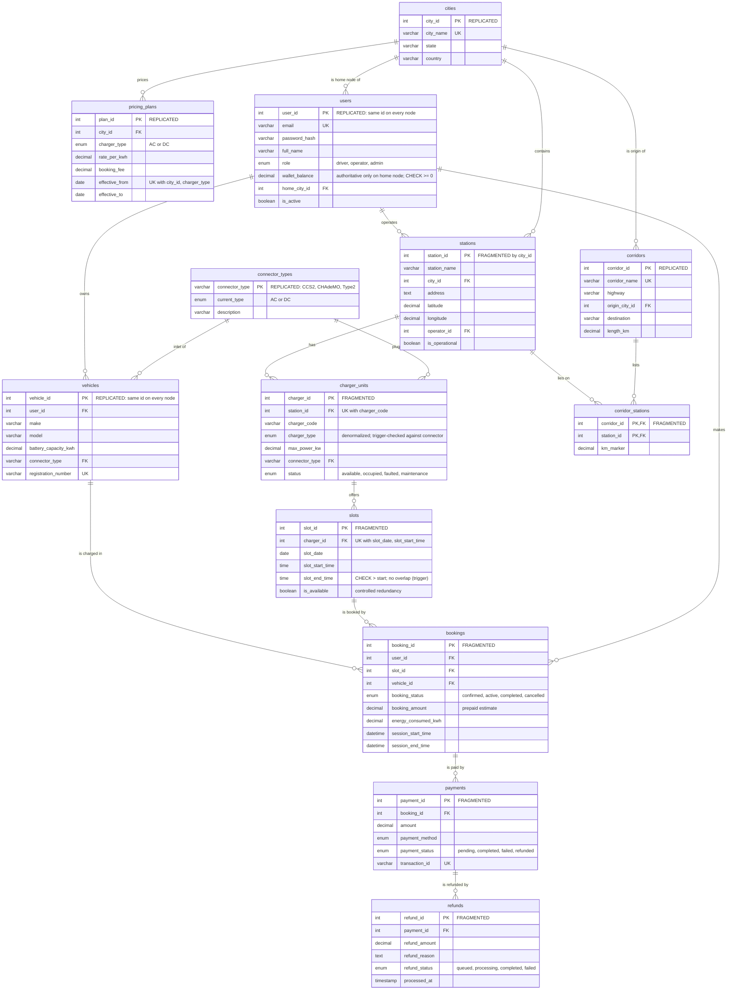

# ER Diagram

Owner: Person 1 (Database). Source of truth: `database/mysql/schema/01_catalog.sql` and `02_core.sql`.
A dbdiagram.io version is in [`er_diagram.dbml`](er_diagram.dbml): paste it into
<https://dbdiagram.io/d> and use *Export → PNG* for the report.

## Data placement

Every table exists on all three MySQL nodes (identical schema). What differs is which **rows** a
node holds:

| Placement | Tables | Rows on each node | IDs |
|---|---|---|---|
| **Replicated** | `cities`, `connector_types`, `pricing_plans`, `corridors`, `users`, `vehicles` | all rows | identical everywhere (users/vehicles: Bangalore issues them) |
| **Fragmented** (horizontal, by city) | `stations`, `charger_units`, `slots`, `bookings`, `payments`, `refunds`, `corridor_stations` | only that city's rows | repeat across nodes; the API addresses rows as `(city, id)` |

In the diagram, the first attribute comment of each entity says **REPLICATED** or **FRAGMENTED**.

## Notes for the viva

- **Cardinalities.** One station has many chargers, one charger many slots. A slot has **at most
  one live booking** (enforced by 2PL in the backend, optionally by
  `optional/double_booking_guard.sql`), but any number of cancelled ones, hence `||--o{`.
  One booking has one payment today. The model allows several payments and several refunds per
  payment, for phase-2 settlement.
- **Weak-entity flavour.** A slot has no meaning without its charger, and its natural key
  `(charger_id, slot_date, slot_start_time)` includes the owner's key. We give it a surrogate
  `slot_id` because bookings reference it and the 2PL transaction locks it by primary key.
  `corridor_stations` is an associative entity (M:N between corridors and stations, with the
  attribute `km_marker`).
- **Cross-node references.** Every foreign key stays inside one node. Fragmented tables only
  reference replicated tables (users, vehicles, catalog) or other fragmented rows of the same
  city, so no foreign key ever crosses nodes.
- **Delete rules.** `bookings`, `payments` and `refunds` are never removed by a cascade: every FK
  into or out of them is `RESTRICT`. Cascades exist only for structural data with no money
  attached (station → chargers → slots, user → vehicles, corridor membership), and they stop at
  the first booking.
